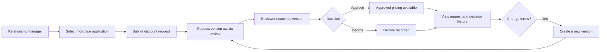
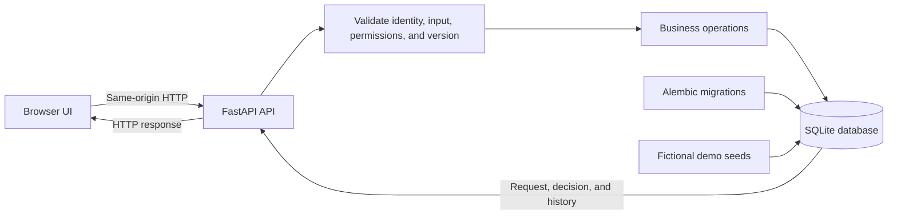
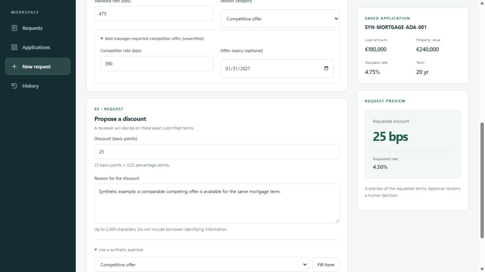
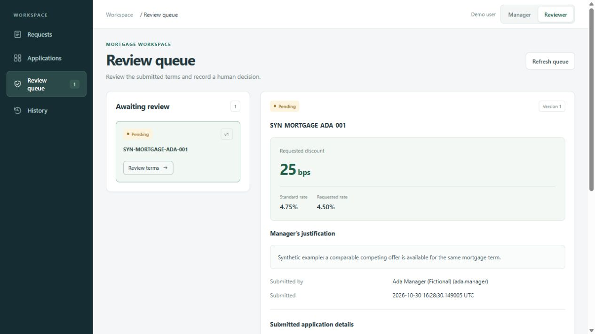
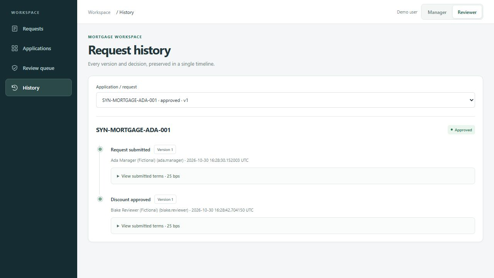

# Mortgage Pricing Exception Service

## Introduction

This project is a demonstration service for handling mortgage pricing exception requests. It models a common step in mortgage pricing: a relationship manager requests a rate discount for an existing application, and a reviewer decides whether to approve it. It focuses on the request and review process; mortgage underwriting and credit approval are outside its scope.

Users work through a browser interface backed by a JSON API. The service stores requests, revisions, decisions, and history in a local database, making it possible to follow how a request changes and why it reached its current outcome. Fictional users and mortgage applications provide data for exploring the workflow.

The project demonstrates an auditable human decision workflow. Its seeded identities are for demonstration only, and optional AI integration is deferred to a later phase.

## Workflow

### Functional workflow



### Technical workflow



Core workflow decisions are made by a human reviewer. AI assessment generation is not part of the current workflow; optional local LLM integration is deferred to Phase 09.

## Methodology

The service treats each submission as a versioned request. Reviewers decide on the exact version they inspect; changing terms creates a new version and requires another review. Decisions and history are retained so the request’s progress can be followed. Synthetic seed data makes the demonstration repeatable, while human approval remains independent of optional AI work.

## Installation

Clone this repository, then choose one of these runtime options:

- **Docker:** Install Docker Desktop with its Linux container engine and Docker Compose v2. Build the image from the repository folder:

```powershell
docker compose build
```

- **No Docker:** Install Python 3.12 and uv 0.11.6. From PowerShell in the repository folder, run:

```powershell
py -3.12 -m pip install uv==0.11.6
uv sync --locked
```

The first setup needs access to the configured image/package registries unless they are already cached. The direct Python option needs Python and package registry access, but no Docker installation or model download. See [Functionality](#functionality) to start the application with your chosen option.

To run directly on Windows after installation, prepare local storage and demo data, then start the service:

```powershell
New-Item -ItemType Directory -Force data | Out-Null
$env:DEMO_IDENTITY_MODE = 'header'
uv run --locked python -m alembic upgrade head
uv run --locked python -m mortgage_pricing.seed
uv run --locked python -m uvicorn mortgage_pricing.main:create_app --factory --host 127.0.0.1 --port 8000
```

Keep this terminal open while using the application. Open <http://127.0.0.1:8000/>; press Ctrl+C in the terminal to stop it. The first setup needs Python/package registry access unless dependencies are already cached. Local data is stored in `data/mortgage_pricing.db`.

## Functionality

### Start the application

From the repository folder, start the service and wait for it to become ready:

```powershell
docker compose up --build --detach --wait
```

Open the application at <http://127.0.0.1:8000/>. The API documentation is at <http://127.0.0.1:8000/docs>. Compose binds to the local machine only. If port 8000 is already in use, choose another host port:

```powershell
$env:APP_PORT = '8080'
docker compose up --build --detach --wait
```

Then open <http://127.0.0.1:8080/>. Startup applies database migrations and ensures the fictional demo records exist. Core mode runs without AI.

### Use the application

**Submit a request.** As Manager, choose **New request**, select an application, check its mortgage details, enter a discount and reason, then select **Submit for review**. Required fields are marked in the form. Use fictional, non-identifying information only.

| Form element | What to enter |
| --- | --- |
| Application | Choose the mortgage application for the request. Each application can have one current request. |
| Mortgage purpose | Select Purchase, Remortgage, or Product transfer. |
| Rate type | Select Fixed, Variable, or Tracker. |
| Loan amount and property value | Check the prefilled saved values; edit only if the terms for this request need different values. Both must be positive amounts. |
| Currency code | Check the three-letter currency code, such as `EUR`. |
| Term (months) | Check or enter the mortgage term in months. |
| Standard rate (bps) | Check or enter the standard rate in basis points; 475 bps is 4.75%. |
| Reason category | Choose Competitive offer, Retention, Relationship, or Other. |
| Competitor offer | Optional. Expand **Add manager-reported competitor offer** to enter its rate and optional expiry. The offer is recorded as unverified. |
| Discount (basis points) | Enter a positive whole number. For example, 25 bps is a 0.25 percentage-point discount. The preview shows the resulting requested rate. |
| Reason for the discount | Explain the commercial reason and supporting information in up to 2,000 characters. Do not enter borrower-identifying data. |

The **Use a synthetic example** control can fill fictional request details and rationale for a demo; it does not submit the request. Review the preview, then select **Submit for review**.



**Review the request.** Switch to Reviewer, open **Review queue**, and select **Review terms**. Check the submitted version and record a human approval or decline.



**Inspect the record.** Open **History** to see the submission and decision as separate events. An approved discount applies to the approved current version; a revision requires a new review.



Screenshots show one synthetic local run. Names, application numbers, and rationale are fictional.

### Configuration

An optional `.env` file in the repository folder lets Docker Compose read settings without typing them into every command. Create it only when you need an override; Compose supplies defaults for the rest. For example, to use a different host port, add:

```dotenv
APP_PORT=8080
```

Compose supports these runtime overrides:

| Variable | Default | When to change it |
| --- | --- | --- |
| `APP_PORT` | `8000` | Change if another process already uses port 8000. |
| `LOG_LEVEL` | `INFO` | Usually leave as is; use `DEBUG` temporarily when diagnosing behavior. |
| `SQLITE_BUSY_TIMEOUT_SECONDS` | `5` | Increase only if concurrent demo writes regularly time out; maximum is 30. |
| `UI_TIMEOUT_SECONDS` | `10` | Increase only if UI requests need longer to complete; maximum is 120. |

For a basic demo, no `.env` file is required. Keep the container’s database path, demo identity mode, and `LLM_MODE=off` as supplied. The `.env` file is ignored by Git; do not put credentials or other secrets in this demo configuration.

## Tech stack

- **Backend:** Python 3.12, FastAPI, and Uvicorn.
- **Frontend:** HTML, CSS, and JavaScript served by the same application process.
- **Data:** SQLite with SQLAlchemy and Alembic migrations.
- **Runtime options:** Docker Compose, or Python and uv for running locally without Docker.
- **Tests:** pytest for Python behavior and Node’s test runner for JavaScript behavior.
