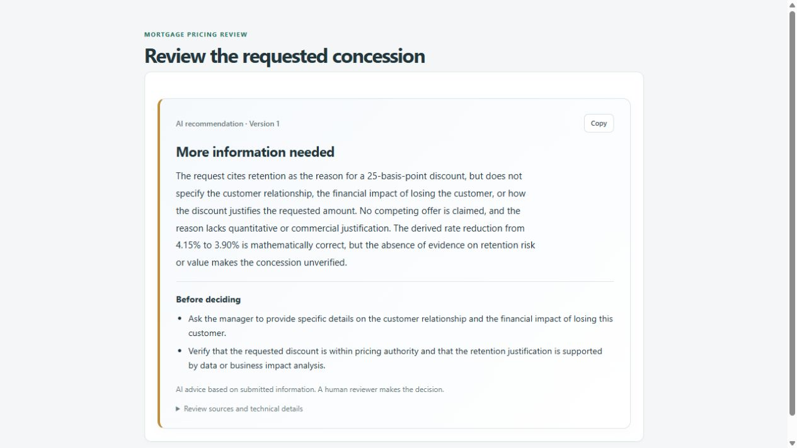

# Mortgage Pricing Exception Service

A versioned mortgage-pricing exception workflow with a browser UI, HTTP API, SQLite history, and optional local AI advice. Managers submit a requested discount and rationale; reviewers approve those exact terms or decline them. Revisions preserve earlier versions and decisions.

This is an exercise release with production-style packaging and operational checks. Demo identities and exercise pricing rules are provided; real customer deployment still requires the controls in [production requirements](docs/production-notes.md).

## Reviewer quick start — Docker only

Install [Docker Desktop](https://docs.docker.com/desktop/setup/install/windows-install/) with Linux containers and Compose. Download and extract the repository ZIP, or clone it if Git is installed. No host Python, uv, Node, or Ollama installation is needed for this path.

From the extracted repository directory:

```powershell
docker compose up --build --detach --wait app
```

Open [http://127.0.0.1:8000/](http://127.0.0.1:8000/). Initial startup creates the demo database and ten fictional applications. Repeated startup preserves requests and history. The app serves both UI and API through one Uvicorn process; SQLite is stored in a named Docker volume.

If port 8000 is occupied, set `$env:APP_PORT = '8001'` before starting Compose and open port 8001. Use [installation](docs/installation.md) for platform commands, local Python setup, and configuration.

## Optional AI — Docker pulls Ollama and the model

The complete human workflow works without AI. To enable the optional local model, run:

```powershell
$env:LLM_MODE = 'auto'
docker compose --profile ai up --build --detach
docker compose --profile ai logs --follow model-init
```

Compose pulls the official pinned Ollama image. The setup job downloads the selected `qwen3:4b-instruct-2507-q4_K_M` model only when it is absent, reports progress, and checks inference readiness. No host Ollama installation or API key is needed. Model weights persist in a separate named volume and are not part of the application image. The first download is several GB; CPU-only inference may be slower than a native GPU installation.

When model setup reports ready, open the reviewer screen, turn AI on for the session, and choose **Get AI recommendation**. A draft explanation streams into a readable card, followed by the validated recommendation and checks before deciding. AI never records approval or changes request status. See [LLM setup, behavior, and evaluation](docs/local-llm.md).



## Functionality

1. Choose **Manager** to create a request for a fictional application. Enter a positive integer discount in basis points, a rationale, and any relevant structured context.
2. Choose **Reviewer**, inspect the exact submitted version, and optionally request AI advice.
3. Use **Approve version** or **Decline version** to record the human decision. Approval accepts the requested amount exactly.
4. Revise a request to create a new pending version. History retains earlier terms, actors, and decisions; old approved terms are not returned as approval of the new version.

A 25-basis-point discount means 0.25 percentage points. AI completeness checks are exercise defaults, not bank pricing policy. A generic retention statement does not itself justify a concession.

The [demo walkthrough](docs/demo.md) covers UI and API scenarios. Interactive API documentation is available at [/docs](http://127.0.0.1:8000/docs). Current business and API contracts are described in [requirements](docs/requirements.md), [API contract](docs/phase-03-api-contract.md), and [data model](docs/current-workflow-and-data-model.md).

## Stop and restart

```powershell
docker compose down
docker compose up --detach --wait app
```

Stopping containers preserves application data and downloaded models. Do not add `--volumes` to an ordinary restart. See [database maintenance and troubleshooting](docs/troubleshooting.md) for backup, reset, readiness, and AI errors.

## Developer checks

The supported Python version is 3.12. With [uv](https://docs.astral.sh/uv/getting-started/installation/) and Node installed:

```powershell
uv sync --locked
uv run --locked python -m pytest -q
uv run --locked python -m ruff check .
uv run --locked python -m ruff format --check .
node --test tests/ui/workspace.test.cjs
```

Ordinary tests use synthetic databases and fake model adapters. Live model evaluation is explicitly invoked and has provisional labels pending human review; see [evaluation protocol](evals/phase09/README.md).

## Release records

- [Project status](docs/project-status.md) and [Phase 09 handoff](docs/handoffs/phase-09.md)
- [Architecture](docs/architecture.md), [decisions](docs/adr/README.md), and [build evidence](docs/build-log.md)
- [AI-use record](docs/ai-usage.md) and [production requirements](docs/production-notes.md)

Do not commit `.env`, databases, model weights, backups, or generated evaluation artifacts.
