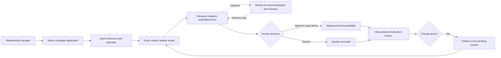
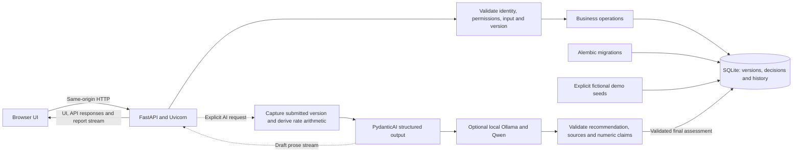
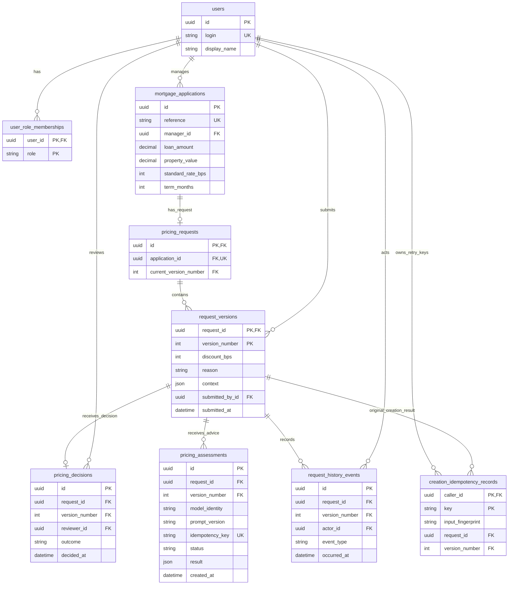

# Mortgage Pricing Exception Service

A versioned mortgage-pricing exception workflow with a browser UI, HTTP API, SQLite history, and optional local AI advice. Managers submit a requested discount and rationale; reviewers approve those exact terms or decline them. Revisions preserve earlier versions and decisions.

This is an exercise release with production-style packaging and operational checks. Demo identities and exercise pricing rules are provided; real customer deployment still requires the controls in [production requirements](docs/production-notes.md).

## Installation

### Reviewer quick start — Docker only

Install [Docker Desktop](https://docs.docker.com/desktop/setup/install/windows-install/) with Linux containers and Compose. Download and extract the repository ZIP, or clone it if Git is installed. No host Python, uv, Node, or Ollama installation is needed for this path.

From the extracted repository directory:

```powershell
docker compose up --build --detach --wait app
```

Open [http://127.0.0.1:8000/](http://127.0.0.1:8000/). Initial startup creates the demo database and ten fictional applications. Repeated startup preserves requests and history. The app serves both UI and API through one Uvicorn process; SQLite is stored in a named Docker volume.

If port 8000 is occupied, set `$env:APP_PORT = '8001'` before starting Compose and open port 8001. Use [installation](docs/installation.md) for platform commands, local Python setup, and configuration.

### Optional AI — Docker pulls Ollama and the model

The complete human workflow works without AI. To enable the optional local model, run:

```powershell
$env:LLM_MODE = 'auto'
docker compose --profile ai up --build --detach
docker compose --profile ai logs --follow model-init
```

Compose pulls the official pinned Ollama image. The setup job downloads the selected `qwen3:4b-instruct-2507-q4_K_M` model only when it is absent, reports progress, and checks inference readiness. No host Ollama installation or API key is needed. Model weights persist in a separate named volume and are not part of the application image. The first download is several GB; CPU-only inference may be slower than a native GPU installation.

When model setup reports ready, open the reviewer screen, turn AI on for the session, and choose **Get AI recommendation**. A draft explanation streams into a readable card, followed by the validated recommendation and checks before deciding. AI never records approval or changes request status. See [LLM setup, behavior, and evaluation](docs/local-llm.md).

## Functionality

### 1. Submit a request as Manager

Choose **New request**, select a fictional application, check the prefilled mortgage details, enter the requested discount and rationale, and select **Submit for review**. The synthetic-example control fills demonstration values without submitting them.

| Form element | What to enter or check |
| --- | --- |
| Application | Select a fictional mortgage application; each application has at most one logical request. |
| Mortgage purpose and rate type | Choose the purpose and rate type for this submitted version. |
| Loan amount and property value | Check the prefilled positive amounts. Changes belong to the new version's context. |
| Currency, term and standard rate | Use a three-letter currency code, a term in months, and a rate in basis points; 475 bps is 4.75%. |
| Reason category | Choose Competitive offer, Retention, Relationship, or Other. |
| Competitor offer | When relevant, enter the manager-reported rate and expiry. The claim remains unverified. |
| Discount | Enter a positive whole number of basis points. A 25-bps reduction is 0.25 percentage points; the preview shows the resulting rate. |
| Reason | Explain the commercial justification and supporting information in up to 2,000 characters. Use fictional, non-identifying data only. |


### 2. Inspect the exact submitted version as Reviewer

Choose **Reviewer**, open a pending request, and review its terms and manager rationale. The reviewer cannot approve their own application or submission. **Approve version** accepts the requested discount exactly; **Decline version** records a decline. The backend rejects a decision if the submitted version has changed.


### 3. Optionally ask for AI advice

If the optional model is enabled and ready, turn AI on for the session and choose **Get AI recommendation**. Read the streamed explanation and suggested next checks. Source references and technical details are available in a collapsed section. Complete fields alone do not justify a concession; a generic retention statement should prompt a request for commercial justification. The human decision buttons remain separate from the AI report.


### 4. Inspect history and revise when needed

Open **History** to see submissions and decisions as separate events. A revision creates a new pending version and preserves earlier terms and decisions. Only an approved current version has an approved discount available through the pricing API.


Screenshots show synthetic demonstration runs; names, application references, and rationale are fictional. The [demo walkthrough](docs/demo.md) provides detailed UI/API scenarios. Interactive API documentation is available at [/docs](http://127.0.0.1:8000/docs), with implemented contracts in [requirements](docs/requirements.md) and the [API contract](docs/phase-03-api-contract.md).

## Workflow

### Functional workflow

A relationship manager requests a discount on a mortgage application. A reviewer examines the exact submitted version and records a decision. Optional AI advice can support that review; only the reviewer records approval or decline.



Approval applies only to the current version that was reviewed. Changing the requested terms creates a new version; earlier decisions remain in history and do not approve the revised terms. Creation retries with the same caller, key, and exact payload replay the original result.

### Technical workflow

One Uvicorn process serves the HTML/CSS/JavaScript UI and FastAPI endpoints. Business operations enforce identity, ownership, roles, versions, and transactions in the backend.



Model inference does not hold a database write transaction. The server checks the version again before saving the final assessment; a revision or decision during generation can make it stale. Core startup, readiness, and human decisions remain available without a model. See [architecture](docs/architecture.md) and [ADR 0011](docs/adr/0011-local-llm-integration.md) for the implementation boundaries.

## Database model

The database contains nine business tables plus Alembic's technical migration-version table. Submitted versions, human decisions, history events, and AI assessments are separate records. The diagram shows the main fields and relationships; [the detailed data model](docs/current-workflow-and-data-model.md) explains the full constraints and storage types.



- Each application has at most one logical request. Its current-version pointer references a version of that same request through a composite foreign key.
- A submitted version has at most one human decision. Reviewer-role and ownership checks prevent self-review; deciding does not edit the submitted terms.
- AI assessments reference the version they assessed. Their JSON result retains the model digest, explanation, evidence references, contract versions, and generation metrics. An assessment is never a human decision.
- Creation retry keys are scoped to the caller. Assessment content keys separately identify the submitted input, model weights, runtime, prompt, rubric, schema, and generation settings.

## Tech stack

| Area | Technology and purpose |
| --- | --- |
| Backend | Python 3.12, FastAPI and Uvicorn for the API and same-origin UI serving |
| Frontend | HTML, CSS and JavaScript; no separate frontend server or build toolchain |
| Persistence | SQLite, SQLAlchemy 2, Decimal monetary values and Alembic migrations |
| Contracts and configuration | Pydantic models and Pydantic Settings |
| Optional product AI | PydanticAI native structured output, Ollama, and `qwen3:4b-instruct-2507-q4_K_M` |
| Packaging | uv and `uv.lock`; one application Dockerfile and one Compose file |
| Verification | pytest, Ruff, Node's built-in test runner, and isolated container checks |
| CI and records | GitHub Actions, phase guides, ADRs, build log, AI-use log and handoffs |

The reviewer path requires only Docker with Compose and a browser. Python, uv, and Node are development tools; the AI profile provides Ollama inside Docker.

## Methodology

### AI-assisted development

Development was organized into numbered phases with explicit acceptance criteria. Codex assisted with requirements analysis, implementation planning, code, tests, documentation, and evaluation tooling. The user set scope, selected the product model, reviewed the UI, and corrected the requested behavior through iterative feedback.

The working method was:

1. Read the current project position, active phase guide, previous handoff, and relevant code before proposing changes.
2. Implement a bounded change while preserving backend business rules, reviewed versions, decisions, and transaction integrity.
3. Check affected behavior with synthetic data and focused tests, then run the required full suite at the phase gate. Use separate live container/model checks for behavior that fakes cannot establish.
4. Inspect the results and correct failures rather than treating generated code or model output as evidence of correctness.
5. Record consequential choices in ADRs, exact verification in the build log, AI contributions and actual review in the AI-use log, and remaining work in status/handoff documents.

[Repository instructions](AGENTS.md) define this workflow. [Phase guides](docs/implementation-plan.md), [decision records](docs/adr/README.md), [build evidence](docs/build-log.md), and the [AI development record](docs/ai-usage.md) show how it was applied. Assistant checks, user feedback, and formal human acceptance are recorded separately.

### AI inside the application

Product AI is a separate, optional feature: the server supplies the exact submitted version, completeness findings, and rate arithmetic to the local model, then validates its structured advisory output before saving it. A short explanation streams to the reviewer, who independently decides. Numeric/source checks and provisional synthetic evaluation help identify defects; they do not prove semantic truth or independently establish accuracy. Human review of the candidate evaluation labels remains pending. See [LLM behavior](docs/local-llm.md) and [evaluation methodology](evals/phase09/README.md).

## Stop and restart

```powershell
docker compose down
docker compose up --detach --wait app
```

Stopping containers preserves application data and downloaded models. Do not add `--volumes` to an ordinary restart. See [database maintenance and troubleshooting](docs/troubleshooting.md) for backup, reset, readiness, and AI errors.

## Developer checks

The supported Python version is 3.12. With [uv](https://docs.astral.sh/uv/getting-started/installation/) and Node installed:

```powershell
uv sync --locked
uv run --locked python -m pytest -q
uv run --locked python -m ruff check .
uv run --locked python -m ruff format --check .
node --test tests/ui/workspace.test.cjs
```

Ordinary tests use synthetic databases and fake model adapters. Live model evaluation is explicitly invoked and has provisional labels pending human review; see [evaluation protocol](evals/phase09/README.md).

## Release records

- [Project status](docs/project-status.md) and [Phase 09 handoff](docs/handoffs/phase-09.md)
- [Architecture](docs/architecture.md), [decisions](docs/adr/README.md), and [build evidence](docs/build-log.md)
- [AI-use record](docs/ai-usage.md) and [production requirements](docs/production-notes.md)

Do not commit `.env`, databases, model weights, backups, or generated evaluation artifacts.
