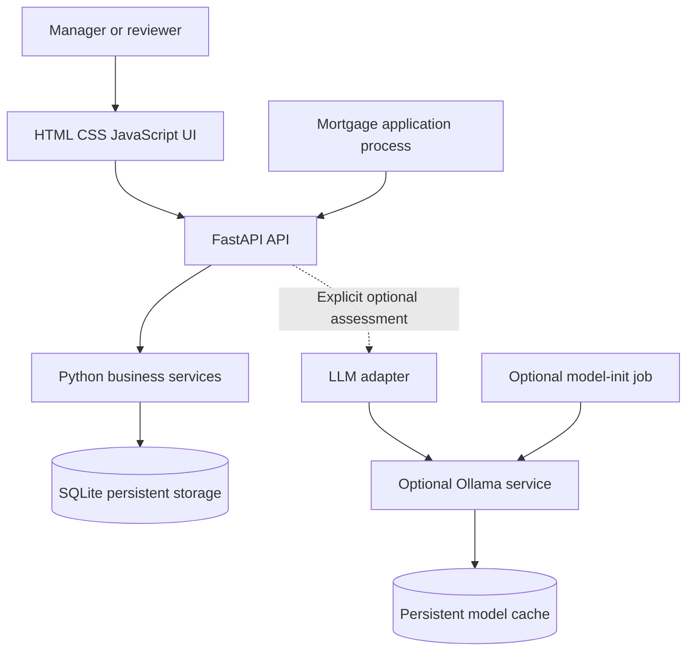

# Proposed architecture

Status: Phases 01-05 are implemented and assistant-verified. Phase 06 now covers UI/database hardening; optional model integration and AI evaluation are deferred to final Phase 09. Use ADRs for rationale.

Phase 01 completed (2026-10-29): packaging, Python 3.12/uv setup, configuration, `/health`, request tracing, and safe error responses are implemented and verified with a fresh environment and 48 passing tests.

Phase 04's separate HTML, CSS, and JavaScript assets in root `ui/` are served by FastAPI from the same process as its HTTP API; see [ADR 0009](adr/0009-single-process-html-ui.md) and the [handoff](handoffs/phase-04.md). The root UI directory is excluded from the Python wheel and must be included in the Phase 05 runtime image.

## Components and boundaries



- **API:** transport validation, configured identity, permissions, consistent errors, and operation tracing.
- **Business services:** creation, revisions, decisions, history, and approved-discount selection. Enforce rules independently of the UI.
- **Persistence:** SQLAlchemy models, database sessions, constraints, and transaction boundaries. Alembic manages schema changes.
- **UI:** FastAPI serves the static browser assets; JavaScript makes same-origin HTTP calls. No direct database writes or model access.
- **AI adapter:** bounded calls to Ollama, structured-response validation, and assessment metadata. No tools that change approval state.
- **Model-init:** wait for the runtime, inspect the local cache, download only if missing, warm up, and report results. It is independent of core API readiness.

## Source layout

Implemented modules are grouped by responsibility; the `ai/` and model-init entries remain Phase 09 plans:

```text
src/mortgage_pricing/
  main.py
  config.py
  container_startup.py
  seed.py
  api/
    errors.py
    foundation.py
    pricing.py
    reads.py
    requests.py
    workflow.py
  domain/
    request_context.py
  observability/
    logging.py
    request_logging.py
  persistence/
  ai/
ui/
  index.html
  styles.css
  app.js
scripts/
  init_model.py
  evaluate_ai.py
migrations/
tests/
```

Use application factories and explicit dependencies where useful to isolate tests. Keep simple business logic in readable services/functions; introduce additional interfaces or repository wrappers only when they improve the implementation.

## Data and operations

Phase 02 adds shared SQLAlchemy metadata with stable constraint names, a lazy SQLite engine factory, an explicit session factory, and the first ORM models under `persistence/`. There are no global engines/sessions or import-time connections. Central settings supply the URL and `SQLITE_BUSY_TIMEOUT_SECONDS` (default 5; greater than 0 and at most 30). PostgreSQL URL forms remain reserved configuration; the factory rejects them before driver loading. SQL echo is off and parameter values are hidden in SQLAlchemy exception text. See [ADR 0002](adr/0002-database-and-seed-data.md).

The owner closes sessions/connections before engine disposal. Each operation owns one session; `factory.begin()` provides commit/rollback/closure, while a plain session context does not implicitly commit. SQLite uses `autocommit=False` and enables foreign keys on every connection. Temporary file-backed tests verify transactional DDL/savepoints, FK rejection, and bounded writer lock errors; the application has no automatic retry. Users have role memberships and applications belong to a user with the relationship-manager role. The composite ownership reference rejects a reviewer-only owner. The API owns a lazy engine for readiness and disposes it at shutdown. Alembic revision `20261029_0001` creates the operational schema; tests use isolated temporary files. The following describes implemented data behavior:

A logical request belongs to one application and contains numbered versions. The composite foreign key ensures its current-version pointer identifies a version of that same request. Each version stores its exact basis-point discount, free-text reason, optional validated structured context snapshot, submitter and UTC time. The context includes non-identifying mortgage attributes and request rationale; its detailed contract is in [ADR 0010](adr/0010-versioned-request-context.md). A decision links to one version, has a reviewer-role decision maker and approved/declined outcome; a unique constraint permits at most one decision per version. Typed history events link to the exact version and actor. Creation idempotency records use caller/key identity, a canonical-input SHA-256 fingerprint, and the original version-1 reference. ORM edits/deletes of submitted versions, decisions, history and retry mappings are rejected; migrations' SQLite triggers also protect stored rows from direct SQL changes. Operations hash deterministic JSON of exact submitted input, replay the original reference for identical caller/key/input, reject changed input, and commit each business change with its history in one transaction.

Step 8 operations use a first-statement no-op UPDATE of the application or request to obtain SQLite's writer lock before mutable reads. Competing writers then serialize and recheck state or receive a bounded lock error; there is no automatic retry. Unique keys remain database-enforced. File-backed tests verify competing decisions/revisions and rollback of failed multi-row writes. Alembic revision `20261029_0001` adds immutable-row triggers; `20261029_0002` adds nullable JSON context to request versions without changing legacy records. See [ADR 0002](adr/0002-database-and-seed-data.md) and [ADR 0010](adr/0010-versioned-request-context.md).

The seed command runs after migrations and inserts only fixed fictional baseline identities and applications. Re-running it preserves unrelated data and does not manufacture pending or decided requests. A clean seeded application remains available for the later create/approve demonstration.

`GET /ready` checks for an existing SQLite file at the current Alembic revision and returns a safe 503 when it cannot use that storage. `GET /health` remains process liveness. The app owns a lazy engine and disposes it at shutdown; optional AI is outside core readiness. See [ADR 0002](adr/0002-database-and-seed-data.md).

Phase 03 implements create/list/inspect, submit revision, decide an exact version, history, current approved pricing, and demo identity/application lookups. The [HTTP contract](phase-03-api-contract.md) and [ADR 0003](adr/0003-business-rules-and-api.md) define validation, permissions, error codes, and 201/200 creation replay semantics. The Phase 04 follow-up adds typed, per-version context snapshots; the API remains compatible with omitted context. Both seeded internal roles read all internal records; owning managers submit/revise, independent reviewers decide. The configured demo login header simulates identity. Approved pricing returns only the current approved version, or a successful `none` outcome for an existing application without current approval. AI availability and assessment operations remain later-phase work.

## Application container and Compose

Maintain **one application Dockerfile** and **one compose.yaml**. Per the user's 2026-10-29 requirement change, one core application service runs one Uvicorn process serving both UI assets and the HTTP API. No separate UI container or reverse proxy is required. A future Python model-init job may reuse the application image; Ollama uses a pinned official image in Phase 09. The model weights are not baked into the application image or committed to Git.

The browser connects directly to the application's host-loopback port. FastAPI serves HTML, CSS, JavaScript, and API routes from the same origin, preserving ADR 0009's single-process runtime and existing HTTP contracts without forwarding or CORS changes. The backend calls `http://ollama:11434` when that future service exists. Container `localhost` refers to that container, not another service. Keep Ollama internal to the Compose network unless a documented local debugging need requires otherwise. See the [updated container requirement](requirements.md#project-additions-selected-by-the-user).

Phase 05 implements this as a digest-pinned, multi-stage Python 3.12.12 image with uv-locked production dependencies. The runtime installs the package non-editably and includes Alembic migrations, logging configuration, and root UI assets. It runs as UID/GID 10001 with a read-only root filesystem. Compose publishes port 8000 on host loopback, mounts a named writable volume at `/app/data`, uses `/ready` as its healthcheck, and bounds the local log driver to three 10 MB files.

The container entrypoint validates file-backed writable SQLite storage, upgrades to Alembic head, inserts only missing fixed synthetic seeds, and then replaces itself with Uvicorn. Preparation failures stop the service before business operations are exposed. `/ready` verifies the current schema and a rollback-only write; `/health` remains process liveness. Core startup sets `LLM_MODE=off` and has no model dependency. See [ADR 0005](adr/0005-containerisation.md).

The named volume preserves business data across normal container recreation; a separate model-cache volume belongs to later AI work. The combined application is the sole core service. Future Ollama/model-init belong to Phase 09 and must not make core startup depend on successful model setup.

## Configuration and AI controls

Use the immutable Pydantic Settings model in `src/mortgage_pricing/config.py`, loaded on demand so application setup and tests can use explicit settings. Values resolve in this order: constructor input, process environment, `.env`, then defaults. `.env.example` documents safe local defaults; real `.env` files are gitignored. `LLM_MODE` accepts `off` and `auto`: `auto` permits later bounded availability discovery but never automatically starts an assessment. It allows the same API configuration to work with or without the Compose AI profile. Profile activation alone does not change API environment variables. Settings construction does not establish database/model connections; the persistence engine connects only when its caller performs I/O.

There are three independent facts:

1. Whether the deployment permits AI calls.
2. Whether the runtime and selected model are ready.
3. Whether the current reviewer has chosen assistance and explicitly requested generation.

The UI toggle is local to the reviewer's session. Off prevents new calls and does not delete assessments, stop the runtime, or silently cancel a call already in flight. A Generate button initiates a call. Check current version again when returning/storing a result; preserve or reject stale results according to the Phase 09 ADR, and never present them as current advice.

## Observability and failures

Operational JSON logs go to stdout/stderr with bounded container retention. Keep correlation identifiers distinct from pricing-request IDs. Persist business history in the database. Core liveness, database readiness, and AI availability are distinct signals; a model failure must not create core restart loops. Phase 05 readiness requires the current Alembic revision and writable SQLite storage, while liveness remains independent.

Step 6 implements stdout JSON logging with one independent logger per app and a ContextVar for request correlation. ASGI middleware validates a single 1-64 character ASCII `X-Correlation-ID` (letter/digit first; then letters/digits/dot/underscore/hyphen), generates UUIDs for other inputs, and returns the ID on responses. Request logs contain method, matched route template, status, outcome, and duration in seconds; arbitrary request data and exception messages are excluded. Uvicorn uses the shared formatter via `config/logging.json`; the documented command disables its raw access log. See ADR 0001 for diagnostics and isolation decisions.

Step 7 centralizes the error envelope and HTTP/validation handlers in `errors.py`. Responses contain `error.code`, `error.message`, and `correlation_id`, with the same ID in the header and request log. Validation input and exception detail payloads are excluded. The existing request boundary handles unexpected exceptions before response start, logs once, and sends a generic 500. Failures after response start are logged and rethrown because an existing response cannot be replaced. Phase 03 maps expected operation failures into this envelope; see [ADR 0003](adr/0003-business-rules-and-api.md).

Model calls have timeouts, limited retries, bounded input/output, and clear UI states. Do not hold database transactions while waiting for a model. Persist model identity/digest, prompt/checklist version, request version, timestamps, and outcome. Avoid raw prompt/body logging by default.

## AI evaluation

The live assistant produces advisory text. A separate evaluation runner measures quality and optionally calls an LLM judge. Use human-labelled references to check the judge; model agreement with itself is not independent evidence. Ordinary tests use explicit fakes and require no model/network. Real model evaluation is separately invoked and labelled.
