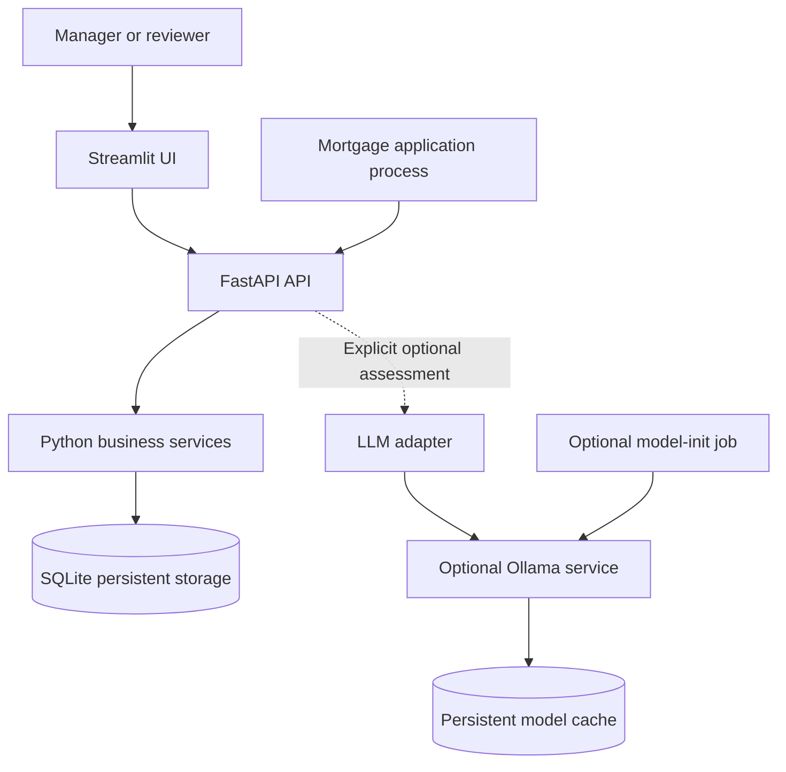

# Proposed architecture

Status: Packaging, configuration, health API, structured logging, request correlation, and safe HTTP errors implemented; broader application architecture remains a design baseline. Update this document as phases complete. Use ADRs for the rationale behind decisions.

Phase 01 progress (2026-10-29): packaging, Python 3.12/uv setup, configuration, `/health`, request tracing, and safe error responses are implemented. Business components and dependency readiness probes remain planned; phase completion verification/handoff remains pending. See [ADR 0001](adr/0001-foundation-config-logging.md).

## Components and boundaries



- **API:** transport validation, configured identity, permissions, consistent errors, and operation tracing.
- **Business services:** creation, revisions, decisions, history, and approved-discount selection. Enforce rules independently of the UI.
- **Persistence:** SQLAlchemy models, database sessions, constraints, and transaction boundaries. Alembic manages schema changes.
- **UI:** Streamlit screens and HTTP calls to the API. No direct database writes or direct model access.
- **AI adapter:** bounded calls to Ollama, structured-response validation, and assessment metadata. No tools that change approval state.
- **Model-init:** wait for the runtime, inspect the local cache, download only if missing, warm up, and report results. It is independent of core API readiness.

## Planned source layout

This is a starting structure, not a requirement to create empty modules or interfaces:

```text
src/mortgage_pricing/
  main.py
  config.py
  logging_config.py
  seed.py
  api/
  domain/
  persistence/
  ai/
ui/
  app.py
  api_client.py
scripts/
  init_model.py
  evaluate_ai.py
migrations/
tests/
```

Use application factories and explicit dependencies where useful to isolate tests. Keep simple business logic in readable services/functions; introduce additional interfaces or repository wrappers only when they improve the implementation.

## Data and operations

A logical request belongs to an application and contains numbered versions. A current-version reference identifies the version eligible for review/use. Each version preserves submitted input; a decision refers to one version. History events and idempotency records are persisted with their associated business operations.

Check-and-update operations must be atomic. Enforce unique keys in the database and handle competing operations explicitly. Store the decision and its history event in the same transaction. Test the actual file-backed SQLite behaviour; a Python-side check alone is insufficient.

The HTTP contract is settled in Phase 03. Expected operations are create/list/inspect, submit revision, decide an exact version, retrieve history, retrieve approved pricing, report health, report AI availability, and explicitly generate an assessment. Define stable machine-readable error codes alongside useful messages.

## Shared image and Compose

Maintain **one application Dockerfile** and **one compose.yaml**. API, UI, and the Python model-init job use the shared application image with different commands. Ollama uses a pinned official image. The model weights are not baked into the application image or committed to Git.

The UI calls `http://api:8000` on the Compose network. The backend calls `http://ollama:11434` when that service exists. Container `localhost` refers to that container, not another service. Publish UI/API demonstration ports to host loopback; keep Ollama internal to the Compose network unless a documented local debugging need requires otherwise.

Use separate named volumes for application data and model cache. API/UI are core services; Ollama/model-init belong to the optional `ai` profile. Do not make core API startup depend on successful model setup.

## Configuration and AI controls

Use the immutable Pydantic Settings model in `src/mortgage_pricing/config.py`, loaded on demand so application setup and tests can use explicit settings. Values resolve in this order: constructor input, process environment, `.env`, then defaults. `.env.example` documents safe local defaults; real `.env` files are gitignored. `LLM_MODE` accepts `off` and `auto`: `auto` permits later bounded availability discovery but never automatically starts an assessment. It allows the same API configuration to work with or without the Compose AI profile. Profile activation alone does not change API environment variables. Step 4 settings are configuration only and do not establish database/model connections.

There are three independent facts:

1. Whether the deployment permits AI calls.
2. Whether the runtime and selected model are ready.
3. Whether the current reviewer has chosen assistance and explicitly requested generation.

The UI toggle is local to the reviewer's session. Off prevents new calls and does not delete assessments, stop the runtime, or silently cancel a call already in flight. A Generate button initiates a call. Check current version again when returning/storing a result; preserve or reject stale results according to the Phase 06 ADR, and never present them as current advice.

## Observability and failures

Operational JSON logs go to stdout/stderr with bounded container retention. Keep correlation identifiers distinct from pricing-request IDs. Persist business history in the database. Core liveness, database readiness, and AI availability are distinct signals; a model failure must not create core restart loops.

Step 6 implements stdout JSON logging with one independent logger per app and a ContextVar for request correlation. ASGI middleware validates a single 1-64 character ASCII `X-Correlation-ID` (letter/digit first; then letters/digits/dot/underscore/hyphen), generates UUIDs for other inputs, and returns the ID on responses. Request logs contain method, matched route template, status, outcome, and duration in seconds; arbitrary request data and exception messages are excluded. Uvicorn uses the shared formatter via `config/logging.json`; the documented command disables its raw access log. See ADR 0001 for diagnostics and isolation decisions.

Step 7 centralizes the error envelope and HTTP/validation handlers in `errors.py`. Responses contain `error.code`, `error.message`, and `correlation_id`, with the same ID in the header and request log. Validation input and exception detail payloads are excluded. The existing request boundary handles unexpected exceptions before response start, logs once, and sends a generic 500. Failures after response start are logged and rethrown because an existing response cannot be replaced. Domain-specific error contracts are Phase 03 work.

Model calls have timeouts, limited retries, bounded input/output, and clear UI states. Do not hold database transactions while waiting for a model. Persist model identity/digest, prompt/checklist version, request version, timestamps, and outcome. Avoid raw prompt/body logging by default.

## AI evaluation

The live assistant produces advisory text. A separate evaluation runner measures quality and optionally calls an LLM judge. Use human-labelled references to check the judge; model agreement with itself is not independent evidence. Ordinary tests use explicit fakes and require no model/network. Real model evaluation is separately invoked and labelled.
