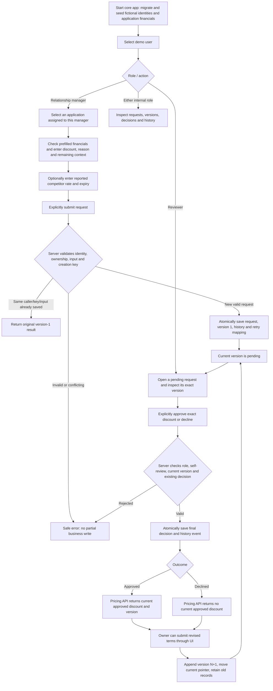
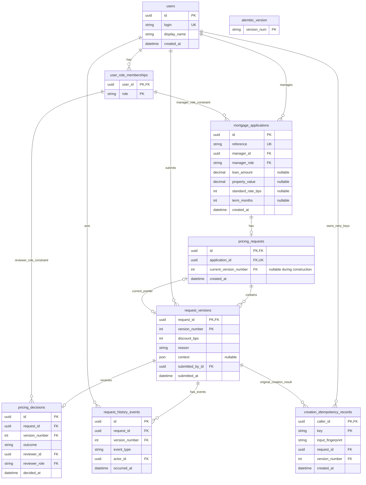

# Current workflow and database model

Code-based description inspected on 2026-10-30. This describes the implemented UI/API and schema, not the proposed redesign or a Belgian bank's lending policy. It does not inspect the contents of the user's live database.

## 1. Current human workflow

- The dropdown supplies `X-Demo-User`; this is simulated identity, not authentication. Managers and reviewers can read internal records. Only an application's owning manager submits/revises it; a reviewer cannot decide a request they own or a version they submitted.
- Each application has at most one logical pricing request. Changing terms uses a new version of that request, not a second logical request.
- The server captures the exact version opened for a decision/revision using `expected_version`. A stale operation fails rather than silently applying to newer terms.
- A decision approves the submitted discount exactly or declines it. There is no reviewer-adjusted discount, decision-comment field, automated eligibility engine, or live LLM assessment.
- Revising an approved version removes that version from current approved-pricing retrieval. The replacement is pending until reviewed; the old decision remains in history.
- Current UI/API difference: the UI shows the revision form only for an approved or declined request. The backend revision operation also permits revising a pending version when the owner and expected-version checks pass. The diagram follows the visible UI; API clients have the additional pending-to-pending revision path.
- Creation retry protection is caller/key/input scoped. An identical replay returns the original version-1 reference, even after later revisions. Reusing the key for changed input conflicts. Revision/decision endpoints have no equivalent creation-key replay record.

## 2. What the relationship manager enters

Selecting an application prefills its loan amount, property value, standard rate and term from saved `mortgage_applications` columns returned by `/demo/applications`. All ten seeded applications have fictional financial values. Remaining context is entered by the manager or filled from synthetic browser examples. The demo application amounts are in EUR; currency remains a request-context field. The app has no external bank application-data feed.

Prefilled values remain editable for the proposed request and are copied into that submitted version's immutable context. Editing a request form does not update the application record. Changing the selected application replaces these four defaults without clearing the entered discount/reason. Browser examples retain the selected application's saved financial defaults. Revision forms continue to start from the reviewed version's snapshot, not a later application-record value.

| Current form field | Required in UI? | Current values / validation | Stored location |
| --- | --- | --- | --- |
| Application | Yes | Select an existing application assigned to the current manager | `pricing_requests.application_id`; its display reference comes from `mortgage_applications.reference` |
| Requested discount | Yes | Positive whole number of basis points | `request_versions.discount_bps` |
| Mortgage purpose | Yes | `purchase`, `remortgage`, `product_transfer` | `request_versions.context.application.purpose` |
| Rate type | Yes | `fixed`, `variable`, `tracker` | `context.application.rate_type` |
| Loan amount | Yes, prefilled | Positive decimal amount; up to two decimal places in the API | Default: `mortgage_applications.loan_amount`; snapshot: `context.application.loan_amount`, serialized as a decimal string |
| Property value | Yes, prefilled | Positive decimal amount; up to two decimal places in the API | Default: `mortgage_applications.property_value`; snapshot: `context.application.property_value`, serialized as a decimal string |
| Currency | Yes | Three uppercase letters; UI defaults to `EUR` | `context.application.currency_code` |
| Term | Yes, prefilled | Positive whole number of months | Default: `mortgage_applications.term_months`; snapshot: `context.application.term_months` |
| Standard rate | Yes, prefilled | Nonnegative whole number of basis points | Default: `mortgage_applications.standard_rate_bps`; snapshot: `context.application.standard_rate_bps` |
| Reason category | Yes | `competitive_offer`, `retention`, `relationship`, `other` | `context.reason_category` |
| Free-text reason | Yes | Nonblank; maximum 2,000 characters | `request_versions.reason` |
| Competitor rate | No | Nonnegative whole number of basis points; entered under the unverified competitor section | `context.competitor_offer.rate_bps` |
| Competitor offer expiry | No | Date; if supplied, a competitor rate must also be supplied | `context.competitor_offer.expires_on` |

`context` paths in this table are inside `request_versions.context`. The create and revision API bodies allow the entire context object to be omitted. If supplied, the structured application fields and reason category are required by its schema. An omitted context is accepted for compatibility, so legacy/API-created versions can have no mortgage context.

The displayed LTV is calculated from loan amount divided by property value, rounded to one decimal place; it is not stored as a separate field. The UI shows standard rate and discount but does not explicitly display a calculated resulting rate. Rates currently use whole basis points; the proposed higher precision is not implemented.

The manager does not enter the actor ID, request/version IDs, submitted timestamp, current-version pointer, history event, input fingerprint or decision. The browser generates and retains the creation retry key for a submitted intent. The backend records actor identity from the demo header and generates business IDs/timestamps/version numbers.

## 3. Database entity-relationship diagram

There are **eight business tables** and the technical `alembic_version` table. Types below are logical types: UUIDs use SQLite `CHAR(32)`, application monetary values use `NUMERIC(14,2)` with Python Decimal values, roles/outcomes/events use checked string enums, and timestamps are handled as UTC by the persistence type. Nullable columns are `pricing_requests.current_version_number`, `request_versions.context`, and the four application financial columns. Null application financials preserve compatibility with unrelated legacy records; seeding backfills missing values for the ten known demo applications without overwriting saved values.

`alembic_version` has no business relationships. The ER diagram shows structural schema cardinalities, including temporarily absent versions/current pointers while creating a request. Successful API creation commits a request with version 1 and a non-null current-version pointer.

## 4. Tables and exact relationships

| Table | Purpose and important constraints |
| --- | --- |
| `users` | Fictional internal identities. UUID primary key; unique login (1–64 characters); display name (1–120 characters); creation time. No password or real authentication data. |
| `user_role_memberships` | Composite primary key `(user_id, role)` prevents duplicate membership. Roles are `relationship_manager` and `reviewer`; a user may structurally have multiple roles. `user_id` references `users.id`. There is no separate roles table. |
| `mortgage_applications` | UUID primary key; unique application reference (1–64 characters); assigned manager and creation time. `manager_id` references `users.id`; `(manager_id, manager_role)` also references `(user_id, role)` in memberships. `manager_role` must be `relationship_manager`. Nullable financial columns store loan amount, property value, standard rate in whole basis points, and term in months. Bounds require positive monetary amounts below 1,000,000,000,000, a nonnegative integer rate, and a positive integer term when present. These are editable application defaults, distinct from immutable submitted snapshots. |
| `pricing_requests` | UUID primary key and unique `application_id`, giving an application zero or one logical request. `application_id` references `mortgage_applications.id`. Composite FK `(id, current_version_number)` references `(request_id, version_number)` in `request_versions`, so the current version must belong to the same request. The pointer is nullable for initial construction. |
| `request_versions` | Composite primary key `(request_id, version_number)`; request FK and submitting-user FK. Positive version number and positive integer discount; nonblank reason of at most 2,000 characters; optional JSON context and submission time. Contains immutable submitted snapshots. |
| `pricing_decisions` | UUID primary key; composite FK `(request_id, version_number)` to the exact submitted version and a unique constraint on that pair, permitting zero or one decision per version. Outcome is `approved` or `declined`. `(reviewer_id, reviewer_role)` references memberships and the role must be `reviewer`; the reviewer user is reached through that membership. Stores decision time but no decision narrative. |
| `request_history_events` | UUID primary key; composite FK to the exact request version; `actor_id` FK to users. Event type is `created`, `revised`, `approved` or `declined`, with event time. No direct FK to a decision row; version/event type identify the associated business action. |
| `creation_idempotency_records` | Composite primary key `(caller_id, key)` scopes a retry key to a user. Caller FK to users and composite FK to the original request version. `version_number` must equal 1. Key is nonblank and at most 128 characters; the input fingerprint is a 64-character lowercase hexadecimal SHA-256 value. Multiple different keys can structurally reference one version; current creation logic inserts the mapping for the successful initial key and rejects a new logical creation for an already-used application. |
| `alembic_version` | Technical schema revision tracking, independent of business records. Current migration head is `20261030_0003`; it adds the four nullable application financial columns after `20261029_0002` added version-context JSON. |

All declared business foreign keys use restricted deletion. The circular request/version relationship is deliberate: versions belong to a request and the request identifies its current version. The API inserts the parent with a null pointer, inserts the first version, then sets the pointer in one transaction.

There is no stored `pending` status column. A version without a decision is pending; a decided version's status comes from its decision outcome. A request's current status is derived from the version selected by its current pointer.

## 5. Integrity and current limits

- Create writes the logical request, version 1, creation history and retry mapping atomically. Revision writes the new version, current pointer and revision event atomically. Decision writes the decision and decision event atomically.
- SQLite foreign-key enforcement is enabled on every connection. Writers obtain the application/request write lock before mutable reads, then recheck ownership/version/decision rules. Lock waits are bounded.
- Submitted versions, decisions, history events and creation retry mappings are protected against updates/deletes by ORM listeners and migration-installed SQLite triggers. Existing submitted context is never rewritten by a revision.
- Role membership is represented structurally in the database. Ownership, stale-version handling and self-review checks also require backend operations; the FK diagram alone does not express every business rule.
- No tables currently exist for AI assessments, competitor lenders/documents, pricing tariffs, margin calculations, customer profitability, insurance conditions or EPC certificates. A narrative may mention such matters, but that does not create structured or verified evidence.
- Demo users/applications are synthetic; the application has no live mortgage-origination-system integration. There is no creditworthiness decision, lending execution or model-driven approval.
- The pending-revision UI/API difference is an observed contract difference to consider during the redesign; this document does not change it.

## Source references and verification scope

- [Form, synthetic examples and browser workflow](../ui/app.js)
- [Structured context schema](../src/mortgage_pricing/domain/request_context.py)
- [Business ORM model](../src/mortgage_pricing/persistence/models.py)
- [Atomic write operations](../src/mortgage_pricing/persistence/operations.py)
- [Database connections/transactions](../src/mortgage_pricing/persistence/database.py)
- [Creation API](../src/mortgage_pricing/api/requests.py), [revision/decision API](../src/mortgage_pricing/api/workflow.py), [reads/status](../src/mortgage_pricing/api/reads.py), [approved pricing](../src/mortgage_pricing/api/pricing.py)
- [Initial migration and immutable-row triggers](../migrations/versions/20261029_0001_initial_database_schema.py), [context migration](../migrations/versions/20261029_0002_request_context.py), [application financial migration](../migrations/versions/20261030_0003_application_financials.py)
- [Synthetic seed identities/applications](../src/mortgage_pricing/seed.py), [version-context design rationale](adr/0010-versioned-request-context.md)

The table/column/FK inventory was checked against SQLAlchemy metadata and the current migration sources. This is documentation of existing behavior, not a new migration, live-database audit, full phase gate, or human acceptance. The proposed additions discussed in chat remain unimplemented.
